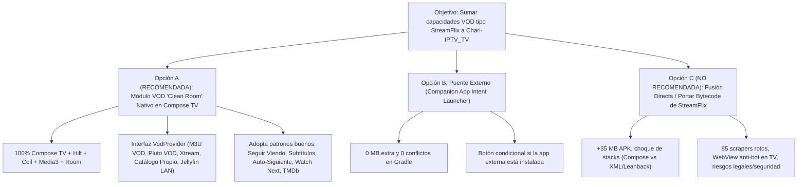
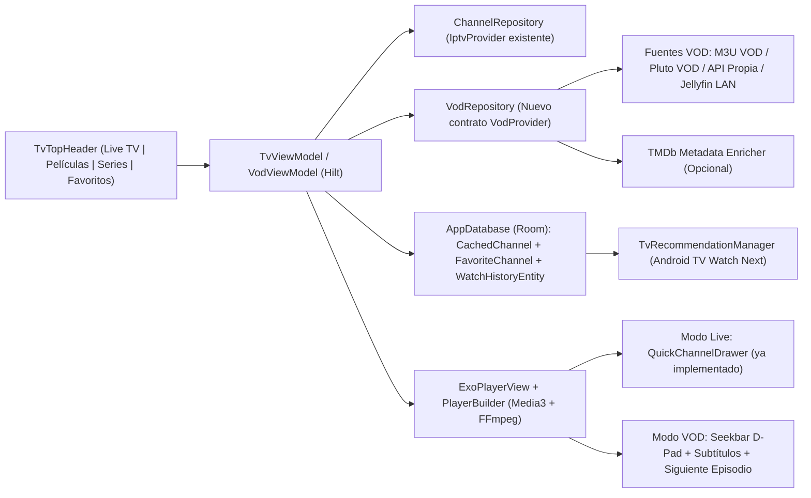

# Informe de Viabilidad y Arquitectura: Integración de StreamFlix en Chari-IPTV_TV

> **Proyecto receptor:** `C:\xampp\htdocs\Chari-IPTV_TV` (`com.example.chariiptv`, v1.1, **Jetpack Compose for TV + Hilt + Media3 + Room**)  
> **Proyecto de referencia:** `C:\xampp\htdocs\streamflix` (`com.streamflixreborn.streamflix`, v1.7.251, APK descompilado en `extracted/`)  
> **Objetivo:** Evaluar técnica, arquitectónica y estratégicamente cómo integrar las capacidades de StreamFlix como parte importante de **Chari-IPTV_TV**, analizando riesgos, incompatibilidades, pros/contras y la ruta de implementación óptima.

---

## 1. Diagnóstico Comparativo: Chari-IPTV_TV vs. StreamFlix

Antes de tomar cualquier decisión de integración, es imprescindible contrastar la arquitectura real de ambos proyectos:

| Dimensión | `Chari-IPTV_TV` (Actual) | `StreamFlix v1.7.251` (`extracted/`) | Impacto de una Fusión Directa |
| :--- | :--- | :--- | :--- |
| **Tipo de artefacto disponible** | Código fuente Kotlin completo y compilable (Gradle KTS). | **Solo APK compilado** y descompresión (`classes*.dex`, XML binarios, `.so`). **No existe código fuente compilable.** | Bloqueador directo: `extracted/` no puede importarse como módulo Gradle. |
| **Framework de UI** | **100 % Jetpack Compose for TV** (`androidx.tv:tv-material`, diseño *Obsidian Cinema TV*). | **XML Layouts + 94 ViewBindings + Fragments + Leanback clásico** (`androidx.leanback`). | Incompatibilidad visual y de navegación D-Pad; obligaría a mantener dos motores UI distintos. |
| **Inyección de Dependencias** | **Dagger Hilt 2.51.1** + KSP (`AppModule.kt`). | Sin DI (singletons `INSTANCE` / `Companion`). | Rompe el patrón limpio y testeable de `Chari-IPTV_TV`. |
| **Motor Multimedia** | **Media3 1.2.0** + **`media3-ffmpeg-decoder` (Jellyfin)** + `LocalHlsProxyServer`. | **Media3** (sin FFmpeg decoder) + `MediaServer` + `SubtitleOffsetRenderersFactory`. | `Chari-IPTV_TV` ya tiene un motor de decodificación de audio/vídeo **superior** al de StreamFlix. |
| **Red y DNS** | **OkHttp 4.12 + `okhttp-dnsoverhttps`** + Retrofit 2.11 (Gson). | OkHttp + `dnsjava` + **Chromium Cronet (5 MB)** + **Conscrypt (2.1 MB)** + Ktor. | Duplicación masiva de pilas HTTP/TLS y sobrecarga de RAM. |
| **Carga de Imágenes** | **Coil Compose 2.6.0** + `coil-svg`. | **Glide** + `AndroidSVG` + módulo Cronet personalizado. | Dos cachés de imágenes compitiendo por la memoria RAM limitada de Android TV. |
| **Persistencia y Usuarios** | **Room 2.6.1** (`CachedChannel`, `FavoriteChannel`). **Sin sistema de usuarios.** | Room v9 (aislado por proveedor) + `ProfileDatabase` + PIN + **Supabase Cloud Sync**. | Contradice la regla de diseño de `Chari-IPTV_TV` (*sin cuentas de usuario*). |
| **Tamaño del APK** | **24.1 MB** (`Chari-IPTV_TV.apk`). | **33.1 MB** (`streamflix-v1.7.251.apk`). | Un APK fusionado rondaría **55–65 MB** (crítico en TV Boxes con 8 GB de almacenamiento). |
| **Proveedores de Contenido** | 4 proveedores IPTV claros y mantenibles (`IptvOrg`, `PlutoTv`, `TdtChannels`, `M3uParser`) bajo `IptvProvider`. | 85 scrapers web de terceros + 103 extractores + **Mozilla Rhino** (JS) + `BypassWebViewActivity` (Cloudflare) + `libstreamflix-keys.so`. | Altísima fragilidad operativa, mala UX con control remoto TV y riesgos legales/seguridad. |

---

## 2. Por Qué NO Conviene Fusionar Directamente `streamflix/extracted`

Aunque StreamFlix aporta excelentes ideas funcionales (catálogo VOD de películas y series, subtítulos, "Seguir viendo", proveedores desacoplados), **incrustar el proyecto StreamFlix directamente dentro de `Chari-IPTV_TV` presenta 5 problemas críticos**:

1. **Imposibilidad técnica de importación directa:** `C:\xampp\htdocs\streamflix\extracted\` contiene bytecode Dalvik (`classes*.dex`), recursos compilados con nombres acortados (`res/8G.xml`, `res/zz.xml`) y binarios `.so`. No es un módulo Gradle; reconstruirlo exigiría descompilar más de 4,700 clases con JADX y reescribir manualmente recursos, bindings y dependencias rotas.
2. **Degradación severa en Android TV Boxes:** La mayoría de los dispositivos Android TV / Fire TV / TV Box tienen **1 a 2 GB de RAM**. Cargar simultáneamente Compose + Leanback XML, Coil + Glide, OkHttp + Ktor + Cronet y el motor JavaScript **Mozilla Rhino** provocaría cierres por falta de memoria (*OutOfMemoryError*) y lentitud en la navegación D-Pad.
3. **Incompatibilidad con la experiencia de TV y tus reglas de producto:**
   * En `Chari-IPTV_TV` definiste que **la interfaz no debe mostrar información o funciones que no funcionan** y que **no hay sistema de usuarios**.
   * Los 85 scrapers externos de StreamFlix cambian de dominio y bloquean peticiones constantemente, forzando la apertura de `BypassWebViewActivity` (un navegador web para resolver retos anti-bot), lo cual resulta **muy frustrante e impráctico con un control remoto de televisor sin ratón**.
4. **Riesgos de seguridad heredados:** Como arrojó la auditoría REA previa ([INFORME_REA_STREAMFLIX_EXTRACTED.md](file:///C:/xampp/htdocs/streamflix/INFORME_REA_STREAMFLIX_EXTRACTED.md)), StreamFlix utiliza perfiles TLS permisivos (`trustAll`), ejecuta JavaScript no confiable de terceros mediante WebView y Mozilla Rhino, y depende de una librería nativa cerrada (`libstreamflix-keys.so`).
5. **Riesgo legal y de distribución:** Redistribuir binarios o scrapers diseñados para eludir protecciones de portales de terceros expone el proyecto `Chari-IPTV_TV` a bloqueos en tiendas oficiales, reclamaciones DMCA y pérdida de confianza de los usuarios.

---

## 3. Análisis de Alternativas Estratégicas

Existen **tres caminos posibles**. A continuación se comparan con sus pros, contras y viabilidad real:

### Opción A (RECOMENDADA): Ingeniería de Sala Limpia (*Clean Room*) — Módulo VOD Nativo en `Chari-IPTV_TV`
En lugar de copiar binarios o código de StreamFlix, se **diseña desde cero un subsistema VOD (Películas y Series)** dentro de `Chari-IPTV_TV` aprovechando las mejores decisiones arquitectónicas descubiertas en el análisis de StreamFlix, pero **100 % nativo en Jetpack Compose for TV, Hilt, Coil, Media3 y Room**.

* **Qué SÍ tomamos como inspiración arquitectónica de StreamFlix (implementado en limpio):**
  1. **Contrato Polimórfico `VodProvider`:** Análogo a tu actual [IptvProvider.kt](file:///C:/xampp/htdocs/Chari-IPTV_TV/app/src/main/java/com/example/chariiptv/domain/provider/IptvProvider.kt), permitiendo enchufar fuentes VOD limpias, sostenibles y configurables:
     * **VOD en listas M3U / Xtream Codes** (separando automáticamente canales *Live* de *Películas/Series*),
     * **Catálogos FAST gratuitos legales** (extender tu actual [PlutoTvProvider.kt](file:///C:/xampp/htdocs/Chari-IPTV_TV/app/src/main/java/com/example/chariiptv/domain/provider/PlutoTvProvider.kt) a su catálogo gratuito On-Demand, Archive.org, etc.),
     * **Catálogo JSON/API propio** administrado por ti (similar al `rss.xml` que ya usas),
     * **Servidores multimedia personales en red local** (Jellyfin / Emby / Plex LAN).
  2. **Enriquecimiento de metadatos con API oficial de TMDb (opcional):** Pósters HD, sinopsis, año, género y calificación real para contenido VOD.
  3. **Persistencia local "Seguir viendo" en Room (`AppDatabase`):** Guardar posición exacta en milisegundos, duración total y último episodio visto — **totalmente local, sin cuentas de usuario ni Supabase**.
  4. **Mejoras en tu reproductor Media3 (`ExoPlayerView` + `PlayerBuilder`):**
     * Modo dual **Live TV** (con tu `QuickChannelDrawer` lateral actual) vs **VOD** (barra de progreso interactiva con D-Pad, adelantar/retroceder 10 s, reanudar donde quedó).
     * Selector de pistas de audio y subtítulos + ajuste de desfase en tiempo real (`SubtitleOffset`).
     * Botón/temporizador de **"Siguiente episodio"** automático para series.
  5. **Integración con Android TV *Watch Next*:** Ampliar tu [TvRecommendationManager.kt](file:///C:/xampp/htdocs/Chari-IPTV_TV/app/src/main/java/com/example/chariiptv/tvrecommendations/TvRecommendationManager.kt) (ya tienes `androidx.tvprovider:tvprovider:1.0.0` instalado) para mostrar películas/series a medias en la pantalla principal del televisor.
  6. **Resiliencia TLS para TVs antiguos:** Incorporar el certificado raíz `ISRG Root X1` (Let's Encrypt) en `network_security_config.xml` para evitar fallos HTTPS en Android TV 7.0 (API 24) sin recurrir al peligroso `trustAll`.
  7. **Respaldo/Restauración local JSON:** Exportar/importar favoritos e historial sin requerir servidores en la nube.

* **Pros:**
  * Cohesión estética 100 % fiel a tu interfaz **Obsidian Cinema TV** (`stitch_interfaz_premium_markdown`).
  * Incremento mínimo de tamaño de APK (**+1 a 2 MB** frente a +35 MB de la fusión).
  * Rendimiento fluido en TV Boxes de 1–2 GB de RAM.
  * Cero riesgos legales, cero dependencias de scrapers rotos y seguridad controlada.
  * Respeta estrictamente tus reglas: **sin cuentas de usuario** y **sin datos falsos**.
* **Contras:**
  * Requiere definir y mantener fuentes VOD legítimas/propias (no trae contenido pirata precargado automáticamente).
  * Mayor esfuerzo de desarrollo inicial frente a un simple acceso directo externo.

---

### Opción B: Integración Desacoplada (*Companion App Bridge*)
Mantener ambas aplicaciones instaladas por separado. `Chari-IPTV_TV` consulta mediante `<queries>` en [AndroidManifest.xml](file:///C:/xampp/htdocs/Chari-IPTV_TV/app/src/main/AndroidManifest.xml) si existe una app VOD complementaria instalada y, **únicamente si está presente**, muestra un acceso directo en la cabecera (`TvTopHeader`) para lanzarla mediante `Intent`.

* **Pros:** Implementación en menos de 1 hora, 0 MB de sobrecarga, 0 riesgo técnico/legal dentro del código de `Chari-IPTV_TV`, cumple la regla de ocultar lo que no está disponible.
* **Contras:** Experiencia visual fragmentada (el usuario sale de Chari-IPTV y entra a otra app con otro diseño y otros controles), requiere instalar dos APKs por separado.

---

### Opción C (NO RECOMENDADA): Fusión Directa / Portar StreamFlix a `Chari-IPTV_TV`
Intentar descompilar el código de `streamflix/extracted` con JADX y empotrar sus paquetes `providers/`, `extractors/`, `fragments/` y librerías nativas dentro de `Chari-IPTV_TV`.

* **Pros:** Reutilización teórica de extractores existentes.
* **Contras:** Inviable sin reescritura masiva (no es fuente compilable), APK de ~60 MB, doble stack UI/Red/Imagen, alto consumo de RAM en TV, vulnerabilidades (`trustAll`, Rhino JS), mantenimiento insostenible de 85 scrapers y problemas legales/de distribución.

---

## 4. Matriz de Decisión Comparativa

| Criterio | Opción A: Módulo VOD Nativo (*Clean Room*) | Opción B: Puente *Companion App* | Opción C: Fusión Directa de `extracted/` |
| :--- | :---: | :---: | :---: |
| **Estabilidad y Rendimiento en TV Box** | Excelente | Excelente | Muy baja (alto riesgo OOM) |
| **Cohesión con diseño *Obsidian Cinema TV*** | Total (100 % Compose TV) | Baja (cambia de app) | Muy baja (Compose + XML Leanback) |
| **Impacto en peso del APK** | ~+1.5 MB (total ~25.5 MB) | ~0 MB (total ~24.1 MB) | ~+35 MB (total ~60 MB) |
| **Cumplimiento "Sin usuarios / Sin datos falsos"** | 100 % | 100 % | Incompatible (perfiles/Supabase/enlaces rotos) |
| **Seguridad y Legalidad** | Alta | Alta | Crítica / Riesgo alto |
| **Mantenibilidad a largo plazo** | Alta (arquitectura modular) | Muy alta | Inviable (85 scrapers externos) |
| **Esfuerzo de desarrollo** | Medio (en fases) | Muy bajo | Muy alto y frágil |

---

## 5. Propuesta de Arquitectura e Implementación por Fases (Opción A — Recomendada)

Si decides avanzar con la **Opción A**, esta es la integración limpia dentro de la estructura real de `C:\xampp\htdocs\Chari-IPTV_TV`:

### Plan de Ejecución Sugerido (4 Fases Incrementales)

* **Fase 1 — Capa de Datos y Contrato `VodProvider`:**
  * Crear el paquete `domain/vod/` (`VodItem`, `VodSeason`, `VodEpisode`, `VodProvider`, `VodRepository`) siguiendo exactamente el patrón de [IptvProvider.kt](file:///C:/xampp/htdocs/Chari-IPTV_TV/app/src/main/java/com/example/chariiptv/domain/provider/IptvProvider.kt).
  * Ampliar [AppDatabase.kt](file:///C:/xampp/htdocs/Chari-IPTV_TV/app/src/main/java/com/example/chariiptv/data/local/AppDatabase.kt) (Room con migración segura) añadiendo `WatchHistoryEntity` (`contentId`, `positionMs`, `durationMs`, `lastWatchedAt`, `seasonNumber`, `episodeNumber`) y `VodFavoriteEntity`.
  * Implementar el primer proveedor VOD limpio (por ejemplo, **Pluto TV VOD gratuito** y/o **parser M3U VOD / JSON propio**).
* **Fase 2 — Interfaz VOD en Jetpack Compose TV (*Obsidian Cinema TV*):**
  * Añadir nuevas pestañas en [TvTopHeader.kt](file:///C:/xampp/htdocs/Chari-IPTV_TV/app/src/main/java/com/example/chariiptv/presentation/components/TvTopHeader.kt) (ej. `Películas` y `Series`, visibles solo cuando hay catálogo VOD disponible).
  * Construir filas horizontales (*LazyRow*) de pósters 2:3 ("Seguir viendo", categorías por género) y pantalla de ficha de detalle (sinopsis real, duración, selector de temporadas y episodios 100 % D-Pad).
* **Fase 3 — Evolución del Reproductor Media3 (`ExoPlayerView.kt`):**
  * Adaptar [ExoPlayerView.kt](file:///C:/xampp/htdocs/Chari-IPTV_TV/app/src/main/java/com/example/chariiptv/player/ExoPlayerView.kt) para operar en **Modo Live** (comportamiento actual + `QuickChannelDrawer` al presionar izquierda) y **Modo VOD** (barra de progreso navegable, salto ±10 s, guardado automático de progreso cada 15 s en Room, selector de audio/subtítulos y botón de siguiente episodio).
* **Fase 4 — Integración Android TV y Resiliencia:**
  * Conectar `WatchHistoryEntity` con [TvRecommendationManager.kt](file:///C:/xampp/htdocs/Chari-IPTV_TV/app/src/main/java/com/example/chariiptv/tvrecommendations/TvRecommendationManager.kt) para alimentar la fila *Seguir viendo* del launcher de Android TV.
  * Añadir `network_security_config.xml` con `ISRG Root X1` (compatibilidad HTTPS para TVs con Android 7.x) y pruebas completas con control remoto en emulador/dispositivo antes de incrementar versión.

---

## 6. Conclusión y Preguntas Clave para Definir el Siguiente Paso

Integrar el **valor funcional y los buenos patrones de ingeniería** de StreamFlix dentro de `Chari-IPTV_TV` es **totalmente viable y potenciará enormemente tu aplicación**, siempre que se haga mediante la **Opción A (módulo VOD limpio nativo en Compose TV)** y **no** intentando fusionar el APK compilado `streamflix/extracted` ni sus scrapers externos.

Antes de iniciar cualquier modificación en `Chari-IPTV_TV`, conviene definir:
1. **¿Qué opción prefieres adoptar?** (Opción A: Módulo VOD nativo propio en Compose TV, u Opción B: acceso directo a app externa).
2. **En caso de elegir la Opción A, ¿cuál será la fuente principal del contenido VOD?** (Por ejemplo: catálogo gratuito de Pluto TV VOD, listas M3U/Xtream VOD, un archivo JSON/API propio gestionado por ti, o conexión a un servidor local Jellyfin/Plex).
3. **¿Deseas incluir también soporte para enriquecimiento de metadatos con TMDb** (pósters y sinopsis) y la sección local de **"Seguir viendo"**?
