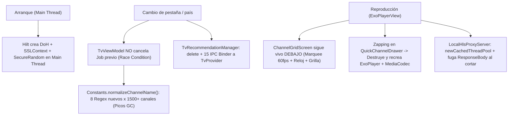

# Informe Técnico de Rendimiento, Cuellos de Botella y Saturación: Chari-IPTV_TV

> **Proyecto auditado:** `C:\xampp\htdocs\Chari-IPTV_TV` (`com.example.chariiptv`, v1.1)  
> **Stack:** Kotlin · Jetpack Compose for TV (`androidx.tv:tv-material`) · Dagger Hilt · Room 2.6.1 · OkHttp 4.12 + DoH · Coil 2.6 · Media3 ExoPlayer 1.2.0 + Jellyfin FFmpeg Decoder  
> **Alcance:** Auditoría completa sobre el 100 % del código fuente en `app/src/main/` y configuración Gradle en `app/build.gradle.kts`.

---

## 1. Resumen Ejecutivo y Diagnóstico General

En comparación con otros clientes IPTV, **Chari-IPTV_TV** parte de una arquitectura muy bien encaminada (sin pings bloqueantes al cargar canales, índice SQL en `CachedChannel`, `Set<String>` para favoritos, `DefaultLoadControl` + `OkHttpDataSource` + `media3-ffmpeg-decoder`, `M3uParser` en streaming con `lineSequence()` y `Dispatcher` independiente en Coil).

Sin embargo, el análisis línea por línea revela **cuellos de botella concretos de CPU/GC, zapping lento, fugas de conexiones en el proxy HLS, recomposición/GPU desperdiciada debajo del reproductor y exceso de llamadas IPC al sistema Android TV** que afectan especialmente a **Android TV Boxes de gama baja/media (1–2 GB RAM)**.

### Mapa de Salud por Subsistema

| Subsistema | Estado | Severidad | Causa Raíz Principal |
| :--- | :---: | :---: | :--- |
| **Proxy HLS Local (`LocalHlsProxyServer`)** | 🔴 Crítico | Crítica | `newCachedThreadPool` sin límite de hilos, fuga de `ResponseBody` al cancelar/cambiar canal y arranque perpetuo en `init`. |
| **Reproductor y Zapping (`ExoPlayerView`)** | 🔴 Crítico | Crítica | Re-creación completa de `ExoPlayer` (MediaCodec + FFmpeg) en cada cambio de canal del cajón lateral + watchdog desincronizado con proxy + `backBuffer` innecesario de 15 s. |
| **Filtrado de Catálogo (`Constants.kt`)** | 🔴 Crítico | Crítica | Compilación de **8 `Regex` nuevos por canal** en `normalizeChannelName()` y creación de listas/strings por canal en `isPanRegionalThematicChannel()` (picos masivos de GC). |
| **Android TV Home / Watch Next** | 🔴 Crítico | Crítica | 18 llamadas IPC Binder al `TvProvider` en **cada cambio de pestaña/país** + inserciones duplicadas infinitas en *Watch Next*. |
| **Concurrencia y Caché** | 🟠 Alto | Alta | `loadFilter` / `loadChannelsByCountry` sin cancelar el `Job` previo, `mutableMapOf` no thread-safe, borrado de Room antes de red y respuestas HTTP sin `.use {}`. |
| **UI Jetpack Compose TV** | 🟠 Alto | Alta | `ChannelGridScreen` (reloj + marquee 60 fps + grilla) sigue montado **debajo** de `ExoPlayerView`; `ImageRequest` recreado sin `remember` ni `.size()`; `.shadow(8.dp)` en cada tarjeta; reordenamiento que rompe prioridad `24/7`. |
| **Arranque y Build Release** | 🟡 Medio | Media | `isMinifyEnabled = false` en `release` (Compose 30–60 % más lento), inicialización de DoH/SSL/SharedPrefs en Main Thread y dependencias sin uso (`Retrofit`, `Gson`, `pingOkHttpClient`). |

### Diagrama de Cuellos de Botella Activos

---

## 2. Hallazgos Críticos (🔴 Prioridad Inmediata)

### C-1. Fuga de Conexiones HTTP, Hilos Ilimitados y Arranque Permanente en `LocalHlsProxyServer`
* **Ubicación:** [LocalHlsProxyServer.kt](file:///C:/xampp/htdocs/Chari-IPTV_TV/app/src/main/java/com/example/chariiptv/player/LocalHlsProxyServer.kt#L30-L39), [L84-L165](file:///C:/xampp/htdocs/Chari-IPTV_TV/app/src/main/java/com/example/chariiptv/player/LocalHlsProxyServer.kt#L84-L165), [L184-L195](file:///C:/xampp/htdocs/Chari-IPTV_TV/app/src/main/java/com/example/chariiptv/player/LocalHlsProxyServer.kt#L184-L195).
* **Qué ocurre:**
  1. **Fuga de `ResponseBody` al cambiar de canal:** En `L119`, `val response = client.newCall(...).execute()` no está envuelto en `.use {}`. Cuando el usuario cambia de canal o cierra el reproductor mientras se transfiere un segmento `.ts`, `input.copyTo(output)` lanza `SocketException` (`Broken pipe`), salta al `catch`, cierra el socket local **pero deja `response` sin cerrar**, filtrando conexiones y buffers en el pool de OkHttp.
  2. **Hilos nativos sin tope:** `Executors.newCachedThreadPool` (`L30`) puede abrir decenas de hilos sin límite bajo ráfagas de reintentos de `IptvLoadErrorPolicy`, consumiendo ~1 MB de stack nativo por hilo.
  3. **Desincronización `Keep-Alive` en segmentos:** En `L143-L148`, copia todas las cabeceras upstream (incluida `Connection: keep-alive`) hacia ExoPlayer, pero inmediatamente cierra el socket en `L161` sin enviar `Connection: close`. Además `input.copyTo(output)` usa buffer de 8 KB (en vídeo 1080p conviene 32–64 KB).
  4. **Arranque en `init` sin cierre:** `LocalHlsProxyServer` abre el `ServerSocket` y mantiene un hilo bloqueado desde que se instancia, aunque no se active el fallback proxy, y `stop()` nunca se invoca.
  5. **`Regex` compilada en bucle:** `L185` compila `"URI=\"([^\"]+)\"".toRegex()` por cada etiqueta `#EXT-X-KEY` de cada recarga de manifiesto (cada 2–6 segundos en HLS en vivo).
* **Solución recomendada:**
  * Arrancar el servidor **solo bajo demanda** dentro de `buildProxyUrl()` (lazy start), usar un pool acotado (`Executors.newFixedThreadPool(8)`), envolver `client.newCall(...).execute().use { response -> ... }`, filtrar el header `Connection` enviando `Connection: close`, usar buffer de `32 * 1024` bytes y mover `KEY_URI_REGEX` al `companion object`.

### C-2. Re-creación Destructiva de `ExoPlayer` al Hacer Zapping + Watchdog Desincronizado + `backBuffer` Innecesario
* **Ubicación:** [ExoPlayerView.kt](file:///C:/xampp/htdocs/Chari-IPTV_TV/app/src/main/java/com/example/chariiptv/player/ExoPlayerView.kt#L228-L235), [L300-L342](file:///C:/xampp/htdocs/Chari-IPTV_TV/app/src/main/java/com/example/chariiptv/player/ExoPlayerView.kt#L300-L342), [PlayerBuilder.kt](file:///C:/xampp/htdocs/Chari-IPTV_TV/app/src/main/java/com/example/chariiptv/player/PlayerBuilder.kt#L39-L48).
* **Qué ocurre:**
  1. **Zapping lento por recreación completa:** `remember(activeStreamUrl, retryCount) { PlayerBuilder.build(...) }` (`L229`) destruye y recrea **todo el motor `ExoPlayer` (`MediaCodec`, `FfmpegAudioRenderer`, `AudioTrack`, `TrackSelector`)** cada vez que el usuario selecciona otro canal en `QuickChannelDrawer`! En TV Boxes esto añade **0.6–2.5 segundos de retardo** por cambio de canal y picos de memoria nativa.
  2. **Watchdog roto al activar el Proxy:** `LaunchedEffect(channel.url, retryCount)` (`L332`) dura 20 s pero **no incluye `useProxyFallback` como clave**. Si un canal geobloqueado falla en el segundo 17 y activa `useProxyFallback = true`, 3 segundos después el watchdog aborta la conexión del proxy con falso timeout. Además, si el canal se congela en buffering al minuto 3, el watchdog ya no está activo.
  3. **Desperdicio de 15–30 MB de RAM en `PlayerBuilder.kt:46`:** `.setBackBuffer(15_000, true)` retiene 15 segundos de vídeo HD ya reproducido en memoria RAM, aunque el reproductor es Live TV puro sin función de retroceso (*timeshift*).
  4. **Doble `release()` potencial:** Tanto `ON_DESTROY` (`L320`) como `DisposableEffect.onDispose` (`L304`) liberan el reproductor.
* **Solución recomendada:**
  * Crear **una única instancia** `val exoPlayer = remember { PlayerBuilder.build(context, okHttpClient) }` y cambiar de señal en `LaunchedEffect(activeStreamUrl, retryCount)` mediante `exoPlayer.setMediaItem(...); exoPlayer.prepare(); exoPlayer.playWhenReady = true`.
  * En `PlayerBuilder.kt`, cambiar `setBackBuffer(0, false)` (ahorra 15–30 MB de RAM inmediata durante la reproducción).
  * Disparar el watchdog con `LaunchedEffect(isBuffering, activeStreamUrl, retryCount)` (solo mientras `isBuffering && !isError`, cubriendo también congelamientos a mitad de emisión y el cambio a proxy).

### C-3. Explosión de CPU y Asignaciones GC en `Constants.normalizeChannelName()` e `isPanRegionalThematicChannel()`
* **Ubicación:** [Constants.kt](file:///C:/xampp/htdocs/Chari-IPTV_TV/app/src/main/java/com/example/chariiptv/util/Constants.kt#L49-L133), [ChannelRepository.kt](file:///C:/xampp/htdocs/Chari-IPTV_TV/app/src/main/java/com/example/chariiptv/domain/ChannelRepository.kt#L100-L111), [L241-L257](file:///C:/xampp/htdocs/Chari-IPTV_TV/app/src/main/java/com/example/chariiptv/domain/ChannelRepository.kt#L241-L257).
* **Qué ocurre:**
  1. `normalizeChannelName()` (`L121-L133`) compila **8 objetos `Regex` nuevos en cada llamada**. Sobre 2,000 canales de `spa.m3u` + TDT + Pluto, crea **16,000+ objetos `Regex`/`Pattern`** en memoria en una sola carga.
  2. `isPanRegionalThematicChannel()` (`L62-L77`) instancia una **`listOf(...)` de 44 Strings** y crea hasta **132 concatenaciones (`"$brand "`, `" $brand "`, `" $brand"`)** por cada canal analizado (~200,000 `String` temporales por escaneo).
  3. En `ChannelRepository.kt:248-257`, encadena `.filter`, `.distinctBy`, `.distinctBy` y `.sortedWith` creando **4 listas intermedias completas** en memoria en lugar de usar `.asSequence()`.
* **Solución recomendada:**
  * Precompilar un único `Regex` combinado (`private val NORMALIZE_REGEX = Regex("\\(\\d+p\\)|\\[(?:not 24/7|geo-blocked|geoblocked)]|\\((?:geo-blocked|sd|hd|fhd)\\)", RegexOption.IGNORE_CASE)`) en `Constants`.
  * Extraer `THEMATIC_BRANDS` y las listas de `isForeignOrBlocked` a propiedades estáticas `private val` (o un único `Regex` precompilado) en el `object Constants` y encadenar el filtrado con `.asSequence()`.

### C-4. Saturación de IPC Binder con Android TV (`TvRecommendationManager`) y Duplicados en *Watch Next*
* **Ubicación:** [TvViewModel.kt](file:///C:/xampp/htdocs/Chari-IPTV_TV/app/src/main/java/com/example/chariiptv/presentation/TvViewModel.kt#L75), [L162](file:///C:/xampp/htdocs/Chari-IPTV_TV/app/src/main/java/com/example/chariiptv/presentation/TvViewModel.kt#L162), [L177](file:///C:/xampp/htdocs/Chari-IPTV_TV/app/src/main/java/com/example/chariiptv/presentation/TvViewModel.kt#L177), [TvRecommendationManager.kt](file:///C:/xampp/htdocs/Chari-IPTV_TV/app/src/main/java/com/example/chariiptv/tvrecommendations/TvRecommendationManager.kt#L25-L128).
* **Qué ocurre:**
  1. **Cada vez que el usuario cambia de pestaña o país**, `TvViewModel` invoca `updateHomeScreenChannels()`, que ejecuta `helper.allChannels`, borra todos los programas del canal y hace **15 llamadas IPC individuales (`publishPreviewProgram`)** hacia `com.android.providers.tv`. Navegar por 5 países genera **90 operaciones Binder + escrituras SQLite en el proceso del launcher**!
  2. `recordWatchedChannel()` (`L97-L128`) llama a `helper.publishWatchNextProgram()` **sin consultar si ya existe un programa con el mismo `internalProviderId` (`channel.url`)**, acumulando duplicados cada vez que se vuelve a ver el mismo canal.
* **Solución recomendada:**
  * Actualizar la fila de Android TV Home **únicamente** cuando cambian los favoritos o una vez por sesión (con *debounce*/throttle), nunca en cada cambio de categoría/país.
  * En `recordWatchedChannel()`, buscar primero por `internalProviderId` y usar `updateWatchNextProgram()` si ya existe, evitando duplicados.

---

## 3. Hallazgos de Severidad Alta (🟠 Concurrencia, Compose TV y Red)

### A-1. `ChannelGridScreen` Sigue Vivo y Animando Debajo de `ExoPlayerView` Durante la Reproducción
* **Ubicación:** [MainActivity.kt](file:///C:/xampp/htdocs/Chari-IPTV_TV/app/src/main/java/com/example/chariiptv/MainActivity.kt#L98-L150), [TvTopHeader.kt](file:///C:/xampp/htdocs/Chari-IPTV_TV/app/src/main/java/com/example/chariiptv/presentation/components/TvTopHeader.kt#L55-L64).
* **Qué ocurre:** `ExoPlayerView` se superpone sobre `ChannelGridScreen` dentro del mismo `Box`. Mientras se reproduce vídeo FHD, detrás siguen ejecutándose el **reloj cada 10 s**, la **marquesina `basicMarquee` a 60 fps** y los nodos/bitmaps de la grilla de 4 columnas, compitiendo por GPU/CPU con la decodificación de vídeo.
* **Solución recomendada:** Renderizar con `if (uiState.currentChannel != null) { ExoPlayerView(...) } else { ChannelGridScreen(...) }` (conservando `LazyGridState` en memoria si se desea mantener la posición de scroll al volver), o pausar reloj/marquee cuando `currentChannel != null`.

### A-2. Race Conditions en `TvViewModel`, Mapas No Thread-Safe y Borrado No Atómico de Room
* **Ubicación:** [TvViewModel.kt](file:///C:/xampp/htdocs/Chari-IPTV_TV/app/src/main/java/com/example/chariiptv/presentation/TvViewModel.kt#L152-L183), [ChannelRepository.kt](file:///C:/xampp/htdocs/Chari-IPTV_TV/app/src/main/java/com/example/chariiptv/domain/ChannelRepository.kt#L32,L61-L119,L126-L140), [IptvOrgProvider.kt](file:///C:/xampp/htdocs/Chari-IPTV_TV/app/src/main/java/com/example/chariiptv/domain/provider/IptvOrgProvider.kt#L21-L78), [PlutoTvProvider.kt](file:///C:/xampp/htdocs/Chari-IPTV_TV/app/src/main/java/com/example/chariiptv/domain/provider/PlutoTvProvider.kt#L20-L52), [TdtChannelsProvider.kt](file:///C:/xampp/htdocs/Chari-IPTV_TV/app/src/main/java/com/example/chariiptv/domain/provider/TdtChannelsProvider.kt#L20-L80).
* **Qué ocurre:**
  1. `loadFilter()` y `loadChannelsByCountry()` no cancelan el `Job` anterior; cambiar rápido de pestaña/país puede provocar que una respuesta lenta anterior **sobrescriba la vista actual**.
  2. `channelsCache` (`ChannelRepository.kt:32`) y `countryCache` (`IptvOrgProvider.kt:22`) son `mutableMapOf` (no thread-safe) accedidos concurrentemente desde `Dispatchers.IO` y `TvChannelBroadcastReceiver`.
  3. En `forceRefresh`, `deleteChannelsByCountry` borra la tabla Room **antes** de descargar la nueva lista y sin `@Transaction` (si falla internet, el usuario pierde su caché local).
  4. Los 3 proveedores + `detectCountryFromIp` llaman a `response.close()` manualmente en vez de `.use {}` (riesgo de fuga de conexiones si `response.body?.string()` lanza `IOException`).
* **Solución recomendada:** Guardar `private var activeLoadJob: Job? = null` y cancelarlo antes de cada nueva carga; usar `ConcurrentHashMap` + `Mutex` en proveedores; usar `.use {}` en toda llamada HTTP; y reemplazar caché Room en una función `@Transaction` **después** de validar que la nueva lista no esté vacía.

### A-3. Coste de Recomposición, Imágenes Sin Límite de Tamaño y Sombras GPU en Grilla y Drawer
* **Ubicación:** [ChannelCardView.kt](file:///C:/xampp/htdocs/Chari-IPTV_TV/app/src/main/java/com/example/chariiptv/presentation/components/ChannelCardView.kt#L58,L127-L139), [QuickChannelDrawer.kt](file:///C:/xampp/htdocs/Chari-IPTV_TV/app/src/main/java/com/example/chariiptv/presentation/components/QuickChannelDrawer.kt#L85,L163,L225-L235), [MainActivity.kt](file:///C:/xampp/htdocs/Chari-IPTV_TV/app/src/main/java/com/example/chariiptv/MainActivity.kt#L82,L239,L549).
* **Qué ocurre:**
  1. `ImageRequest.Builder(LocalContext.current)...build()` se crea **sin `remember`** y **sin `.size(widthPx, heightPx)`** en cada tarjeta (`ChannelCardView`), cada fila (`QuickChannelDrawer`) y el HUD (`ExoPlayerView`), decodificando PNG/SVG de alta resolución para miniaturas de `34 dp` y recreando el objeto en cada recomposición.
  2. `.shadow(elevation = 8.dp)` en todas las tarjetas de `LazyVerticalGrid` y `elevation = 24.dp` en `QuickChannelDrawer` sobrecargan la GPU de TV Boxes de gama baja durante el scroll rápido.
  3. `key = { index, channel -> "${channel.url}_$index" }` acopla la clave al índice (rompe el reciclaje eficiente al mutar la lista) y `remember(channels) { channels.sortedBy { it.name } }` (`MainActivity.kt:239`) re-ordena en el **Main Thread** destruyendo la priorización de canales `24/7` que ya hizo `ChannelRepository` (`L106-L111`)!
  4. `MainActivity.kt:82` usa `collectAsState()` en vez de `collectAsStateWithLifecycle()`.
  5. En `TvTopHeader.kt:55-64`, el estado `currentTime` vive en el mismo composable que la `LazyRow` de pestañas, causando recomposición de todo el header cada 10 s (además de crear un nuevo `SimpleDateFormat` en cada tick).
* **Solución recomendada:** Memorizar `ImageRequest` con `.size(160, 110)` (o `72, 72` en drawer) y `.crossfade(false)` en listas; reemplazar `.shadow()` por borde/superficie tonal; eliminar el `sortedBy` duplicado en `MainActivity`; usar `key = { _, ch -> ch.url }`; aislar el reloj en su propio `@Composable private fun LiveClockBadge()`; y usar `collectAsStateWithLifecycle()`.

### A-4. Trabajo Síncrono en el Main Thread al Arrancar (`AppModule` + `TvViewModel`)
* **Ubicación:** [TvDroidApplication.kt](file:///C:/xampp/htdocs/Chari-IPTV_TV/app/src/main/java/com/example/chariiptv/TvDroidApplication.kt#L16-L17), [AppModule.kt](file:///C:/xampp/htdocs/Chari-IPTV_TV/app/src/main/java/com/example/chariiptv/di/AppModule.kt#L41-L74,L129-L157), [TvViewModel.kt](file:///C:/xampp/htdocs/Chari-IPTV_TV/app/src/main/java/com/example/chariiptv/presentation/TvViewModel.kt#L28-L39).
* **Qué ocurre:** Inyectar `OkHttpClient` directamente en `TvDroidApplication` obliga a Hilt a construir `DnsOverHttps` (`File` en `cacheDir`, `InetAddress.getByName`), `SSLContext` y `SecureRandom` en el **Main Thread** durante `Application.onCreate()`. Además, en `AppModule` existen `providePingOkHttpClient`, `provideRetrofit` y `provideM3uApiService` que **no se utilizan en ninguna clase**, y `okhttp` `maxRequestsPerHost = 16` en Coil puede saturar simultáneamente hosts de logos lentos.
* **Solución recomendada:** Inyectar `dagger.Lazy<OkHttpClient>` en `TvDroidApplication` (para que se inicialice fuera del arranque frío cuando Coil lo necesite en segundo plano) y eliminar `Retrofit`, `converter-gson`, `M3uApiService` y `pingOkHttpClient` si no se usan.

---

## 4. Hallazgos de Severidad Media (🟡 Build Release, Memoria y Limpieza)

| ID | Ubicación | Problema | Solución |
| :--- | :--- | :--- | :--- |
| **M-1** | [app/build.gradle.kts](file:///C:/xampp/htdocs/Chari-IPTV_TV/app/build.gradle.kts#L22-L26) | `isMinifyEnabled = false` y sin `isShrinkResources = true` en `release`. Penaliza el rendimiento de Jetpack Compose TV entre **30 % y 60 %** y deja código muerto (`Retrofit`, `Gson`, `kotlin.serialization`) en el APK. | Activar `isMinifyEnabled = true` + `isShrinkResources = true` en `release` y retirar dependencias sin uso. |
| **M-2** | [TvDroidApplication.kt](file:///C:/xampp/htdocs/Chari-IPTV_TV/app/src/main/java/com/example/chariiptv/TvDroidApplication.kt#L46-L56) | `MemoryCache` fija al `25 %` del heap y `100 MB` de disco sin distinguir TV Boxes de 1 GB RAM (`memoryClass < 192`). | Adaptar a `15 %` / `50 MB` en dispositivos con poca RAM (`ActivityManager.memoryClass < 192`). |
| **M-3** | [MainActivity.kt](file:///C:/xampp/htdocs/Chari-IPTV_TV/app/src/main/java/com/example/chariiptv/MainActivity.kt#L75) | `FLAG_KEEP_SCREEN_ON` activo en toda la app, incluso en menús estáticos (riesgo de *burn-in* OLED). | Activarlo únicamente dentro de `DisposableEffect` en `ExoPlayerView`. |
| **M-4** | [TvViewModel.kt](file:///C:/xampp/htdocs/Chari-IPTV_TV/app/src/main/java/com/example/chariiptv/presentation/TvViewModel.kt#L69-L92) | `getFavoritesFlow()` dispara una segunda consulta `getFavoriteChannels()`, y el bucle RSS `while(true)` sigue activo en segundo plano. | Observar directamente `favoriteDao.getFavoriteChannelsFlow()` y pausar/limitar refresco RSS según ciclo de vida. |
| **M-5** | [AppModule.kt](file:///C:/xampp/htdocs/Chari-IPTV_TV/app/src/main/java/com/example/chariiptv/di/AppModule.kt#L95-L106) | `SSLContext.getInstance("SSL")` + `trustAllCerts` aplicado globalmente a todas las conexiones (incluyendo GitHub, GeoIP y RSS). | Usar TLS estándar (`"TLS"`) para APIs/logos y restringir TLS permisivo solo al cliente de streaming IPTV si es necesario. |

---

## 5. Plan de Optimización Priorizado (3 Fases)

1. **Fase 1 — Rendimiento de Zapping, Proxy HLS y Filtrado CPU/GC (Mayor impacto perceptible):**
   * Reutilizar una única instancia de `ExoPlayer` en `ExoPlayerView`, arreglar el watchdog (`useProxyFallback` + `isBuffering`) y quitar `setBackBuffer(15_000, true)` en `PlayerBuilder`.
   * Corregir `LocalHlsProxyServer`: arranque perezoso, pool fijo de 8 hilos, `.use {}` en `OkHttp`, `Connection: close`, buffer 32 KB y `Regex` estática.
   * Precompilar `Regex` y listas constantes en `Constants.kt` + usar `.asSequence()` en `ChannelRepository`.
2. **Fase 2 — Concurrencia, Estabilidad de Datos y Android TV IPC:**
   * Cancelar `Job` anterior en `TvViewModel`, usar `ConcurrentHashMap` + `.use {}` + `@Transaction` en Room/proveedores.
   * Desacoplar `TvRecommendationManager.updateHomeScreenChannels()` de los cambios de pestaña/país y evitar duplicados en `recordWatchedChannel()`.
3. **Fase 3 — Fluidez 60 fps en Compose TV, Arranque Rápido y Build Release:**
   * Desmontar/pausar `ChannelGridScreen` mientras se reproduce vídeo en `ExoPlayerView`, aislar el reloj en `TvTopHeader`, memorizar `ImageRequest` con `.size(...)`, retirar `.shadow()` de tarjetas, corregir `key` y `sortedBy` duplicado.
   * Usar `Lazy<OkHttpClient>` en `TvDroidApplication`, eliminar `Retrofit`/`Gson`/`pingOkHttpClient` sin uso, y activar `isMinifyEnabled = true` + `isShrinkResources = true` en `release`.
