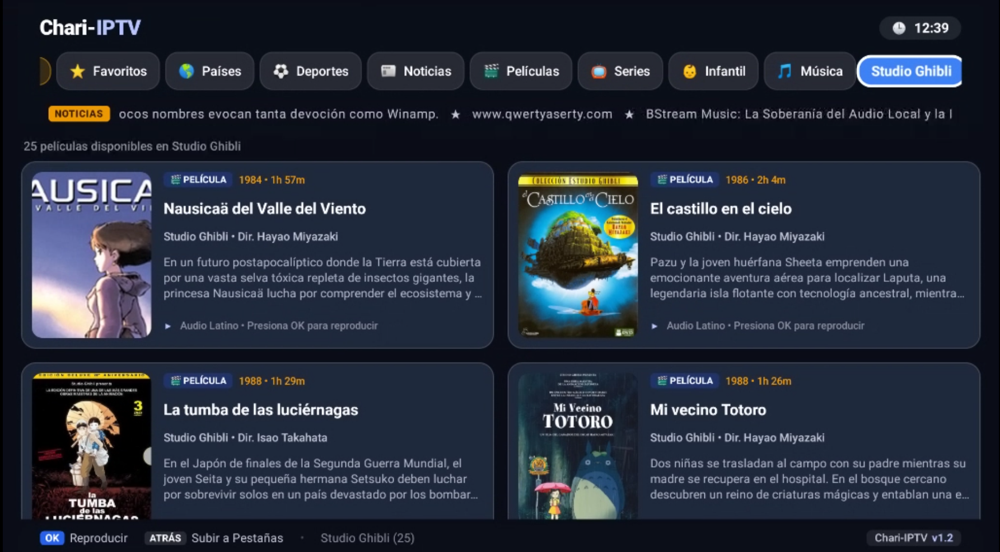

# 📺 Chari-IPTV (v1.2)

Aplicación nativa moderna para Smart TVs y dispositivos **Android TV, Google TV y Fire TV Sticks**. Diseñada especialmente para disfrutar de televisión en vivo y cine bajo demanda en español con una experiencia visual fluida, elegante y totalmente adaptada al control remoto de la sala de estar.

---

<p align="center">
  
  
</p>

---

## ✨ Características de la Versión 1.2

* 📺 **Televisión en Vivo 100% en Español:** Canales organizados por categorías temáticas (**Deportes, Noticias, Películas, Series, Infantil, Música**) y explorador de países hispanohablantes (Perú, Argentina, España, México, Colombia, Chile y más) con detección automática de país por región.
* 🎬 **Colección Oficial Studio Ghibli (25 Películas):** Catálogo cinematográfico completo en riguroso orden cronológico (1984–2023) desde *Nausicaä del Valle del Viento* hasta *El chico y la garza*, en audio latino de alta calidad y con sinopsis detallada.
* ⏱️ **Reanudación Inteligente de Películas:** Si sales de una película de Studio Ghibli o apagas la app, al volver a entrar la aplicación te preguntará automáticamente si deseas **Continuar donde lo dejaste** (indicando el minuto exacto) o **Comenzar de nuevo** desde el principio.
* ⚡ **Zapping Lateral sin Salir del Video (Quick Drawer):** Al presionar la flecha **Izquierda (◀)** del control remoto mientras reproduces un canal, se despliega una lista lateral para cambiar de canal al instante sin interrumpir la transmisión.
* ⭐ **Lista de Favoritos:** Guarda tus canales preferidos fácilmente manteniendo presionado el botón central (**OK**) en la lista o presionando **Arriba (▲)** durante la reproducción.
* 🎨 **Diseño Obsidian Cinema TV:** Interfaz visual con fondo oscuro puro ideal para televisores OLED, tarjetas de alta visibilidad y marcos de enfoque luminosos que facilitan la navegación a distancia.
* 🚀 **Integración con la Pantalla de Inicio:** Fila nativa de canales destacados en la pantalla principal de Android TV para acceder a tus contenidos con un solo clic.
* 🔒 **100% Libre y Privada:** No requiere registro, no pide inicio de sesión, no contiene publicidad intrusiva ni rastreadores.

---

## 🎮 Controles de Navegación (Mando a Distancia)

| Botón del Control | En la Pantalla Principal | Durante la Reproducción (TV en Vivo) | Durante la Reproducción (Studio Ghibli) |
| :--- | :--- | :--- | :--- |
| **OK / Centro** | Abrir canal o película seleccionada | Mostrar / Ocultar barra de información | Pausar / Reanudar la película |
| **◀ Izquierda** | Moverse entre tarjetas | Abrir menú lateral de canales rápidos | Retroceder 15 segundos |
| **▶ Derecha** | Moverse entre tarjetas | Cerrar menú lateral | Avanzar 15 segundos |
| **▲ Arriba** | Subir a las pestañas y filtros | Añadir o quitar canal de Favoritos (⭐) | - |
| **▼ Abajo** | Bajar a la cuadrícula de canales | - | Desplegar catálogo lateral de películas |
| **Atrás (Back)** | Subir directamente al menú superior | Salir al menú principal | Menú de salida / volver a la lista |

---

## 📥 Instalación en Smart TV o TV Box

El archivo instalador listo para usar es **`Chari-IPTV_1.2.apk`**.

### Opción 1: Mediante Memoria USB (Recomendado)
1. Descarga el archivo `Chari-IPTV_1.2.apk` y cópialo en una memoria USB (Pendrive).
2. Conecta la memoria USB a tu televisor o TV Box.
3. Abre cualquier explorador de archivos en tu TV (por ejemplo *X-plore*, *File Commander* o el gestor de archivos de tu televisor) e instala el APK.

### Opción 2: Mediante Apps de Transferencia (Sin cables)
1. Instala en tu televisor y en tu teléfono/PC una app de transferencia como **"Send Files to TV"** o **"LocalSend"** (disponibles gratis en Google Play Store).
2. Envía el archivo `Chari-IPTV_1.2.apk` directamente por Wi-Fi e instálalo.

### Opción 3: Vía ADB (Para usuarios avanzados)
Si tienes activada la depuración USB o de red en tu dispositivo:
```powershell
adb install -r Chari-IPTV_1.2.apk
```

---

## ☕ Apoyo y Donaciones

Chari-IPTV es un proyecto desarrollado con dedicación y de libre acceso para la comunidad. Si la aplicación te resulta útil y deseas apoyar el mantenimiento y futuras mejoras, puedes colaborar voluntariamente:

* **PayPal (Internacional):** Disponible directamente desde el botón **"Importante"** en la barra superior de la app.
* **Yape (Perú):** Código QR disponible en la ventana **"Importante"** de la app.
* **Portal Oficial:** [www.qwertyaserty.com](https://www.qwertyaserty.com)

---

## ⚖️ Aviso Legal y Propiedad Intelectual

1. **Naturaleza del Software:** Chari-IPTV es exclusivamente una aplicación cliente reproductora de medios. No aloja, no almacena, no retransmite ni posee servidores propios de streaming audiovisual.
2. **Fuentes de Emisión:** Todos los enlaces a canales de televisión provienen de repositorios públicos y abiertos de internet (*iptv-org*, *TDTChannels*).
3. **Contenido Cinematográfico:** Los enlaces a las obras de Studio Ghibli hacen referencia a archivos públicos alojados en plataformas de preservación histórica digital (como *Internet Archive*).
4. **Marcas y Derechos:** Los nombres, logotipos y contenidos pertenecen exclusivamente a sus respectivos titulares y cadenas de televisión. Las obras de animación son propiedad intelectual de *Studio Ghibli Inc.* y sus respectivos autores.
