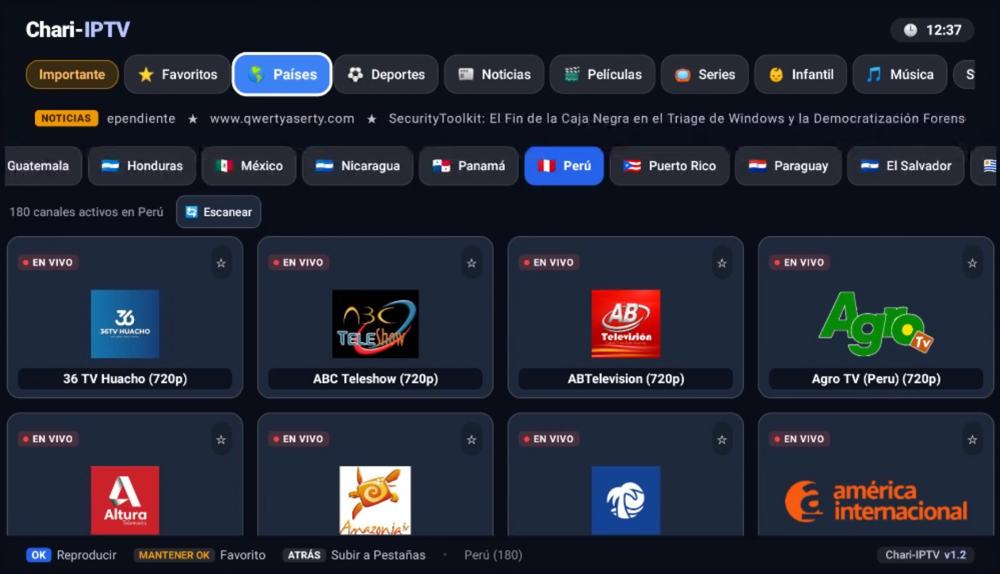

# 📺 Chari-IPTV (Edición Smart TV & TV Box) v1.2

[](https://developer.android.com/tv)
[](https://kotlinlang.org)
[](https://developer.android.com/jetpack/compose/tv)
[]()
[]()
[](https://github.com/RiderCalcina/Chari-IPTV-Cel)
[]()

**Chari-IPTV** es una aplicación nativa moderna de alto rendimiento desarrollada exclusivamente para Smart TVs y dispositivos **Android TV, Google TV y Fire TV Sticks**. Diseñada especialmente para disfrutar de televisión abierta en vivo y cine bajo demanda en español con una experiencia visual cinematográfica, fluida y totalmente adaptada al mando a distancia de la sala de estar y al ecosistema interconectado con [Chari-IPTV Cel (Edición Móvil)](https://github.com/RiderCalcina/Chari-IPTV-Cel).

---

<p align="center">
  
  
</p>

---

## ✨ Características Principales de la Versión 1.2

* 📺 **Televisión en Vivo 100% en Español:** Canales organizados por categorías temáticas (**Deportes, Noticias, Películas, Series, Infantil, Música**) y explorador de países hispanohablantes (Perú, Argentina, España, México, Colombia, Chile y más) con detección automática de región.
* 🎬 **Colección Oficial Studio Ghibli (25 Películas):** Catálogo cinematográfico íntegro en riguroso orden cronológico (1984–2023) desde *Nausicaä del Valle del Viento* hasta *El chico y la garza*, en audio latino de alta calidad y con sinopsis detallada.
* ⏱️ **Reanudación Inteligente de Películas:** Si sales de una película de Studio Ghibli o apagas la app, al volver a entrar la aplicación te preguntará automáticamente si deseas **Continuar donde lo dejaste** (indicando el minuto exacto) o **Comenzar de nuevo** desde el principio.
* ⚡ **Zapping Lateral sin Salir del Video (Quick Drawer):** Al presionar la flecha **Izquierda (◀)** del control remoto mientras reproduces un canal, se despliega una lista lateral para cambiar de canal al instante sin interrumpir la transmisión actual.
* ⭐ **Gestión de Favoritos:** Guarda tus canales preferidos fácilmente manteniendo presionado el botón central (**OK**) en la lista o presionando **Arriba (▲)** durante la reproducción en vivo.
* 🎨 **Diseño Obsidian Cinema TV:** Interfaz visual con fondo oscuro puro ideal para paneles OLED/QLED, tarjetas de alta visibilidad y marcos de enfoque luminosos que facilitan la navegación a distancia.
* 🚀 **Integración con la Pantalla de Inicio:** Fila nativa de canales recomendados en el launcher principal de Android TV para acceder a tus contenidos con un solo clic.
* 🌐 **Servidor Micro-HTTP LAN & Descubrimiento mDNS (Novedad v1.2):**
  * Servidor HTTP local embebido que escucha en el puerto `8990`.
  * Difusión automática mediante mDNS (`_chari-tv._tcp.`) que permite ser descubierta al instante por teléfonos con [Chari-IPTV Cel](https://github.com/RiderCalcina/Chari-IPTV-Cel).
  * Protección Anti-SSRF estricta: solo acepta conexiones provenientes de subredes privadas locales (RFC 1918).
  * Control remoto total desde el celular: cruceta virtual, volumen, botones de navegación, teclado remoto (**Buscar en TV**) y sincronización bidireccional de favoritos en tiempo real.
  * Sintonización remota optimizada: al recibir una señal enviada desde el celular, la Smart TV reproduce el stream directamente vía su propio ExoPlayer, liberando al móvil y apagando el reproductor/audio local en el teléfono.
* 🔒 **100% Libre y Privada:** No requiere registro, no pide inicio de sesión, no contiene publicidad intrusiva ni rastreadores.

---

## 🎮 Controles de Navegación (Mando a Distancia Físico)

| Botón del Control | En la Pantalla Principal | Durante la Reproducción (TV en Vivo) | Durante la Reproducción (Studio Ghibli) |
| :--- | :--- | :--- | :--- |
| **OK / Centro** | Abrir canal o película seleccionada | Mostrar / Ocultar barra de información | Pausar / Reanudar la película |
| **◀ Izquierda** | Moverse entre tarjetas | Abrir menú lateral de canales rápidos (Zapping) | Retroceder 15 segundos |
| **▶ Derecha** | Moverse entre tarjetas | Cerrar menú lateral de zapping | Avanzar 15 segundos |
| **▲ Arriba** | Subir a las pestañas y filtros superiores | Añadir o quitar canal de Favoritos (⭐) | - |
| **▼ Abajo** | Bajar a la cuadrícula de canales | - | Desplegar catálogo lateral de películas |
| **Atrás (Back)** | Subir directamente al menú superior | Salir al menú principal | Menú de salida / volver a la lista |

---

## 📲 Ecosistema Interconectado con Chari-IPTV Cel

Al utilizar conjuntamente **Chari-IPTV (TV)** y **[Chari-IPTV Cel (Móvil)](https://github.com/RiderCalcina/Chari-IPTV-Cel)** en la misma red Wi-Fi:

```text
┌─────────────────────────────────┐               ┌─────────────────────────────────┐
│     Chari-IPTV Cel (Móvil)      │               │     Chari-IPTV (Smart TV)       │
│                                 │               │                                 │
│  - Descubrimiento mDNS auto     ───────────────▶  - Broadcaster mDNS (_chari-tv)│
│  - Botón "Enviar a TV"          │  REST / HTTP  │  - Micro-HTTP Server (Port 8990)│
│  - Cruceta D-Pad táctil         │───────────────▶  - Inyector de eventos D-Pad    │
│  - "Buscar en TV" (Teclado)     │  (Subred LAN) │  - Sintonización directa ExoPlay│
│  - Sincronización Favoritos     │               │  - Base de datos Room TV        │
│    (Bidireccional)              │               │                                 │
└─────────────────────────────────┘               └─────────────────────────────────┘
```

1. **Sintonización Instantánea:** Toca cualquier canal en el celular y presiona "Enviar a TV"; la tele sintoniza la señal de inmediato vía ExoPlayer nativo y el celular detiene su reproducción local y audio automáticamente.
2. **Control Remoto Táctil:** Usa la cruceta circular en la pantalla de tu móvil si se te extravió el control de la tele o no tiene pilas.
3. **Búsquedas Rápidas (Buscar en TV):** Escribe los nombres de los canales desde el teclado del celular en vez de navegar letra por letra en la pantalla grande.
4. **Sincronización Bidireccional de Favoritos:** Fusiona e iguala la lista de canales favoritos entre el celular y la TV con un solo botón ("Sincronizar Favoritos").

---

## 📥 Métodos de Instalación en Smart TV o TV Box

El archivo instalador listo para usar es **`Chari-IPTV_1.2.apk`**.

### Opción 1: Mediante Memoria USB (Recomendado)
1. Descarga el archivo `Chari-IPTV_1.2.apk` y cópialo en una memoria USB (Pendrive).
2. Conecta la memoria USB a tu televisor o TV Box.
3. Abre cualquier explorador de archivos en tu TV (por ejemplo *X-plore*, *File Commander* o el gestor de archivos de tu televisor) e instala el APK.

### Opción 2: Mediante Apps de Transferencia (Sin cables)
1. Instala en tu televisor y en tu teléfono/PC una app de transferencia como **"Send Files to TV"** o **"LocalSend"** (disponibles gratis en Google Play Store).
2. Envía el archivo `Chari-IPTV_1.2.apk` directamente por Wi-Fi e instálalo.

### Opción 3: Vía ADB (Para usuarios avanzados)
Si tienes activada la depuración USB o de red en tu dispositivo:
```powershell
adb install -r Chari-IPTV_1.2.apk
```

---

## 📦 Compilación y Código Fuente

### Requisitos
* JDK 17
* Android SDK 36 (Android 15 / 16 Preview)
* Android Studio Ladybug / Koala o superior

### Pasos de Compilación

1. Clonar el repositorio:
```bash
git clone https://github.com/RiderCalcina/Chari-IPTV-TV.git
cd Chari-IPTV-TV
```

2. Compilar el APK Release optimizado:
```bash
./gradlew :app:assembleRelease
```

3. El APK final se generará en:
```text
app/build/outputs/apk/release/Chari-IPTV_1.2.apk
```

---

## 📖 Documentación y Guías

* 📘 **[Guía de Ayuda Completa y Manual de Usuario TV](GUIA_AYUDA_USUARIO.md):** Manual detallado paso a paso sobre el funcionamiento de la aplicación en el televisor, controles avanzados, uso del servidor local y resolución de problemas comunes.
* 📱 **[Repositorio Chari-IPTV Celular](https://github.com/RiderCalcina/Chari-IPTV-Cel):** Código fuente, control remoto virtual y guía de la versión móvil complementaria.

---

## ☕ Apoyo y Donaciones

Chari-IPTV es un proyecto desarrollado con dedicación y de libre acceso para la comunidad. Si la aplicación te resulta útil y deseas apoyar el mantenimiento y futuras mejoras, puedes colaborar voluntariamente:

* **PayPal (Internacional):** Disponible directamente desde el botón **"Importante"** en la barra superior de la app.
* **Yape (Perú):** Código QR disponible en la ventana **"Importante"** de la app.
* **Portal Oficial:** [www.qwertyaserty.com](https://www.qwertyaserty.com)

---

## ⚖️ Aviso Legal y Propiedad Intelectual

1. **Naturaleza del Software:** Chari-IPTV es exclusivamente una aplicación cliente reproductora de medios. No aloja, no almacena, no retransmite ni posee servidores propios de streaming audiovisual.
2. **Fuentes de Emisión:** Todos los enlaces a canales de televisión provienen de repositorios públicos y abiertos de internet (*iptv-org*, *TDTChannels*).
3. **Contenido Cinematográfico:** Los enlaces a las obras de Studio Ghibli hacen referencia a archivos públicos alojados en plataformas de preservación histórica digital (como *Internet Archive*).
4. **Marcas y Derechos:** Los nombres, logotipos y contenidos pertenecen exclusivamente a sus respectivos titulares y cadenas de televisión. Las obras de animación son propiedad intelectual de *Studio Ghibli Inc.* y sus respectivos autores.
